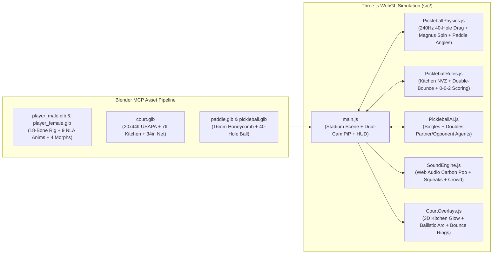

# 🏓 PPA Tour 3D Pickleball Simulator & Interactive USAPA Rule Trainer

A realistic **3D WebGL Pickleball Simulation Game** and **Interactive USAPA Rule Trainer** built with **Three.js**, **Web Audio API**, and **Blender MCP** procedurally generated 3D human athletes, equipment, and court assets.

---

## 📸 Actual Live Game Screenshots

### 1. PPA Pickleball Tour 2025 Broadcast View (Clean Broadcast Mode)

*PPA Pickleball Tour 2025 indoor/night championship arena featuring the 3-tone blue acrylic court (`SELKIRK` Kitchen stencils, `PPA PICKLEBALL TOUR` baseline logo, `erne`, `PICKLEBALL.COM`, `VERSIX`, and `THORLO` apron decals), portable tournament net with `FILA` banners and T-foot bases, royal-blue back sponsor barrier with 4 floral planters, back arena mural (`OS1st`, `THORLO`, `PPA PICKLEBALL TOUR 2025`, `SELKIRK`), courtside VIP lounge sofa, broadcast cinema camera on tripod, and floating **`PERFECT`** shot timing callout.*

### 2. PPA Championship 2v2 Doubles Match (`0 - 0 - 2` Side-Out Scoring & Full Broadcast HUD)

*Full 2v2 Championship Doubles match with interactive ESPN/PPA Tour TV Scorebug, USAPA Coach banner, Live 3D Emotion PiP cam, and distinct pro athlete kits (**Arjun**: sky-blue long-sleeve performance kit; **Priya**: navy jersey & pleated court skirt; **Vikram**: black short-sleeve jersey over white long compression sleeves + headband; **Ananya**: lavender performance tee & pleated white skirt).*

### 3. Athlete & Selkirk Carbon Paddle Close-Up Cam (`Face Cam` + Forward Ready Grip)

*Close-up portrait view of **Arjun** holding the **Selkirk T700 Raw Carbon-Fiber Paddle** in a natural forward continental grip (`Hand.R` origin aligned at the palm grip center), showcasing realistic athletic shoulder deltoids, layered performance apparel, wide split-step ready stance, and live facial morph targets.*

### 4. Kitchen Net Cam & 40-Hole Paddle Contact / Spin Lab

*Sideline Non-Volley Zone ("Kitchen") camera angle alongside **Ananya (AI)** at the 7-foot Kitchen line, with the interactive **Paddle Contact Angles & 40-Hole Lab** drawer open for real-time pitch, yaw, brush spin, and crosswind tuning.*

### 5. Overhead Tactical Hawkeye View

*Top-down tactical view highlighting USAPA 20×44 ft 3-tone blue court geometry, `SELKIRK` 7-foot Non-Volley Zone ("The Kitchen") stencils, doubles footwork coverage, and 240Hz Magnus spin trajectory arcs.*

---

## ✨ Key Highlights

### 1. Pro Pickleball Athletes, Layered Apparel & Forward Paddle Grip (Via Blender MCP)
- **Anatomically Proportioned Male & Female Pro Athletes** (`public/assets/player_male.glb`, `public/assets/player_female.glb`):
  - **Arjun** & **Priya** (Team Near) and **Vikram** & **Ananya** (Team Far) sculpted and rigged in Blender with athletic V-taper torsos, smooth deltoid shoulder skinning, natural wide split-step stances (`±0.21m` foot spacing), dedicated material slots (`Headband_Mat`, `Forearm_Sleeve_Mat`, `Shirt_Mat`, `Shorts_Mat`), and distinct pro tournament kits (including pleated athletic skirts for female players and compression sleeves/headbands).
- **Forward Continental Paddle Grip (`public/assets/paddle.glb`)**:
  - Elongated **Selkirk T700 Raw Carbon-Fiber Paddle** (`16.5" × 7.5"`, 16mm polypropylene honeycomb core, crimson/white `S` logo, crimson edge guard, perforated leather grip) exported with origin `(0, 0, 0)` at the palm grip center so `Hand.R` holds the handle naturally in front of the chest (`~38°` forward pitch).
- **4 Subtle Facial Emotion Shape Keys (Morph Targets)**:
  - `Celebration`, `Frustration`, `Effort`, and `Surprise` morph targets blended in real time.
- **10 Rigged Skeletal Animations (NLA Tracks)**:
  - **7 Court Strokes & Footwork**: `Idle_SplitStep`, `Run_Footwork`, `Serve_Underhand`, `Dink_Crosscourt`, `ThirdShot_Drop`, `Volley_Kitchen`, `Smash_Overhead`.
  - **2 Full-Body Human Emotion Reactions**: `Celebrate_FistPump` and `Frustrated_Slump`.
  - **1 Courtside Lounge Pose**: `Seated_Spectator` for the VIP courtside sofa guests.
- **Live 3D "Human Emotion Cam" (Picture-in-Picture)**:
  - A secondary Three.js portrait camera (`faceCamera`) renders a live 60 FPS front-facing close-up of the athlete's face and upper body directly inside the top-right broadcast HUD.

### 2. PPA Pickleball Tour 2025 Indoor/Night Championship Arena
- **3-Tone Blue USAPA Tournament Court (`public/assets/court.glb` + 4K Acrylic Stencil Shader)**:
  - Exact USAPA dimensions (`6.096 m × 13.4112 m`), deep indigo service courts (`#162fa0`), bright sky-blue **7-foot Non-Volley Zone ("The Kitchen", `#5380eb`)**, royal-blue run-off apron (`#1f47b8`), crisp on-court sponsor stencils (`SELKIRK`, `PPA PICKLEBALL TOUR`, `erne`, `PICKLEBALL.COM`, `VERSIX`, `THORLO`), and a **portable tournament net system** with heavy black steel T-foot bases, bottom stabilizer bar, center strap, and dual `FILA` net banners.
- **Indoor/Night Championship Broadcast Environment**:
  - Back arena mural wall (`OS1st`, `THORLO`, `PPA PICKLEBALL TOUR 2025`, `SELKIRK`), royal-blue baseline sponsor barrier (`VERSIX`, `FILA`, `erne`, `TOPCOURT`, `THORLO`, `Pickleball Central`, `PICKLEBALL.COM`), 4 tall black rectangular planters with lush purple/magenta/white flowers, angled glowing blue sideline LED barriers, upper-left **courtside VIP lounge sofa** with throw pillows, coffee table, water bottles, and seated spectators, plus an upper-right **broadcast cinema camera on tripod**.

### 3. Broadcast TV HUD, Floating `"PERFECT"` Callouts & Clean Broadcast Mode
- **Floating 3D Shot-Quality Callouts**: Striking in the sweet-spot window spawns a bold neon-green **`PERFECT`** floating 3D sprite above the player alongside a vertical golden-yellow ball-strike streak.
- **Clean Broadcast View Toggle (`H` Key / Top-Bar Button)**: Toggle between the full interactive ESPN/PPA Tour HUD and an unobstructed **Clean Broadcast View** that showcases the full arena.
- **ESPN / PPA Tour TV Scorebug & Interactive Keycaps**: Live serving indicators, official `0 - 0 - 2` USAPA 3-number call box, real-time **Double-Bounce Rule Status Strip**, and interactive `[W][A][S][D]`, `[1]–[6]` Shot Type keycaps.

---

## 🏗️ System Architecture



---

## 🎮 Controls & On-Screen Key Guide

| Input / Key | Action | Details |
| :--- | :--- | :--- |
| **Mouse Move** | **Aim Target Reticle** | Moves the 3D target reticle and live ballistic trajectory arc on the opposing court |
| **Hold & Release `SPACE`** *(or **Left-Click**)* | **Serve / Strike Ball** | Charges shot power (`35%–100%`) and swings the paddle on release |
| **`1`** | **Topspin Drive / Serve** | Deep baseline topspin drive (`+1850 RPM`) or legal underhand serve |
| **`2`** | **Crosscourt Kitchen Dink** | Soft lifted arc that drops inside the opponent's 7ft Non-Volley Zone |
| **`3`** | **Aggressive 3rd-Shot Drop** | High-margin transition drop from baseline into the Kitchen after Bounce #2 |
| **`4`** | **Kitchen-Line Punch Volley** | Compact reflex punch volley out of the air (outside the 7ft Kitchen) |
| **`5`** | **Overhead Smash** | High-velocity leaping put-away winner against high balls/lobs |
| **`6`** | **Backspin Slice** | Open-face backspin cut (`-1650 RPM`) that floats via Magnus lift and skids low |
| **`W` `A` `S` `D`** *(or **Arrow Keys**)* | **Court Footwork** | Manual player movement (works seamlessly alongside **Auto-Footwork Assist**) |
| **`Q` / `E`** | **Paddle Face Pitch** | Close paddle face (`-15°` low drive) ↔ Open paddle face (`+20°` lofted dink/drop) |
| **`Z` / `C`** | **Paddle Face Yaw** | Angle paddle face Inside-Out Left (`-25°`) ↔ Crosscourt Right (`+25°`) |
| **`R` / `F`** | **Swing Brush Spin** | Increase Topspin brush (`+25°`) ↔ Increase Backspin slice (`-25°`) |
| **Right-Click + Drag** | **Orbit 3D Camera** | Freely orbit, pan, and zoom the 3D stadium camera |

---

## 🎯 Game Modes

1. **🎓 Training Coach Mode (Interactive USAPA Rule Tutorial)**:
   - **Lesson 1 — The Non-Volley Zone ("The Kitchen")**: Learn the 7-foot no-volley rule and land 3 soft crosscourt dinks inside the Kitchen.
   - **Lesson 2 — Legal Underhand Serve**: Strike legal underhand pendulum serves below the waist into the highlighted diagonal service court.
   - **Lesson 3 — The Double-Bounce (Two-Bounce) Rule**: Let the opponent's return bounce once (Bounce #2), then execute a **3rd-Shot Drop (`[3]`)** into the Kitchen to advance to the net.
   - **Lesson 4 — Side-Out Scoring (`0-0-2`)**: Play live points where only the serving team scores.
   - **Lesson 5 — 40-Hole Aerodynamics & Spin Lab**: Experiment with paddle pitch, yaw, topspin Magnus dip, backspin float, and crosswind.
2. **⚡ Singles Mode (1v1 Match)**:
   - Full USAPA Singles rules with even (`Right`) and odd (`Left`) server court positioning against **Vikram (Tour AI)**.
3. **🏆 Doubles Mode (2v2 Co-op & AI Match)**:
   - Full USAPA `0-0-2` three-number scoring with **Priya (AI Partner)** coordinating kitchen-line transitions, serving rotations (`Server #1` / `Server #2`), and Left/Right side switches against **Vikram & Ananya (AI)**.

---

## 🔬 High-Precision Physics & Spatial Audio

- **40-Hole Aerodynamic Drag & Magnus Effect (`src/physics/PickleballPhysics.js`)**:
  - Sub-stepped at `240 Hz` using 4th-order Runge-Kutta / semi-implicit Euler integration:
    $$\mathbf{a} = \mathbf{g} - \frac{1}{2 m}\rho A C_d \|\mathbf{v}_{\text{rel}}\|\mathbf{v}_{\text{rel}} + \frac{1}{2 m}\rho A C_L \frac{\boldsymbol{\omega} \times \mathbf{v}_{\text{rel}}}{\|\boldsymbol{\omega}\|} \|\mathbf{v}_{\text{rel}}\|^2$$
  - Models a `26 g`, `73.66 mm` USAPA 40-hole outdoor ball ($C_d = 0.44$, $C_L = 0.21$), parabolic net cord collisions (`34"` center / `36"` posts), and spin-coupled acrylic court restitution.
- **Web Audio API Spatial Synthesis (`src/audio/SoundEngine.js`)**:
  - Procedural **T700 Raw Carbon-Fiber** (`1.15 kHz`) and **Pro Graphite** (`1.48 kHz`) honeycomb paddle "pop" transients, FM rubber court-shoe squeaks, hollow polymer court bounces, dynamic crowd cheers/gasps, and spoken referee score announcements.

---

## 🚀 Quick Start & Verification

### Prerequisites
- **Node.js** `>= 18.x` and **npm**

### Install & Run Locally
```bash
# 1. Clone the repository
git clone https://github.com/cmanikandan/pickleball.git
cd pickleball

# 2. Install dependencies
npm install

# 3. Start the Vite development server (http://localhost:5173/)
npm run dev
```

### Run Automated Verification Suite & Production Build
```bash
# Verifies all 5 Blender GLB assets, 9 animations, 4 emotion shape keys,
# 40-hole Magnus physics, USAPA Kitchen/Double-Bounce/0-0-2 rules, and AI agents:
npm test

# Build production bundle to dist/
npm run build
```

---

## 📁 Project Structure

```text
pickleball/
├── AGENTS.md                       # AI Coding Agent, Blender MCP & Multi-Agent Architecture Guide
├── README.md                       # Project documentation, controls, architecture & setup
├── index.html                      # TV Broadcast Scorebug, Live 3D Emotion PiP & Keycap HUD
├── package.json                    # Scripts and dependencies (three, vite)
├── public/assets/                  # Blender MCP generated 3D GLB assets
│   ├── court.glb                   # 20x44ft USAPA court, 7ft Kitchen & 34"/36" parabolic net
│   ├── paddle.glb                  # 16mm honeycomb core + T700 carbon-fiber paddle
│   ├── pickleball.glb              # 73.66mm USAPA outdoor ball with 40 circular holes
│   ├── player_male.glb             # Rigged male athlete (Arjun) + 9 animations + 4 emotion morphs
│   └── player_female.glb           # Rigged female athlete (Priya) + 9 animations + 4 emotion morphs
├── public/screenshots/             # Actual live in-game WebGL screenshots
│   ├── broadcast_view.png          # Pro broadcast center court view & USAPA coach
│   ├── doubles_match.png           # 2v2 championship doubles match in action
│   ├── athlete_closeup.png         # Close-up hero portrait of athlete & T700 carbon paddle
│   ├── kitchen_angle_lab.png       # Kitchen net cam & 40-hole paddle contact / spin lab
│   └── overhead_tactical.png       # Overhead tactical Hawkeye view
├── src/
│   ├── main.js                     # Three.js WebGL scene, outdoor stadium, PiP camera & loop
│   ├── style.css                   # Broadcast UI styling & interactive keycap animations
│   ├── ai/PickleballAI.js          # Multi-agent tactical AI (Singles, Doubles partner/opponents)
│   ├── audio/SoundEngine.js        # Web Audio API spatial synthesis engine
│   ├── physics/PickleballPhysics.js# 240Hz 40-hole drag, Magnus spin & paddle contact solver
│   ├── rules/PickleballRules.js    # USAPA rule validator & 5 interactive training modules
│   └── ui/CourtOverlays.js         # 3D holographic court overlays & trajectory preview
└── tests/
    └── verify_simulation.mjs       # Automated verification test suite
```
