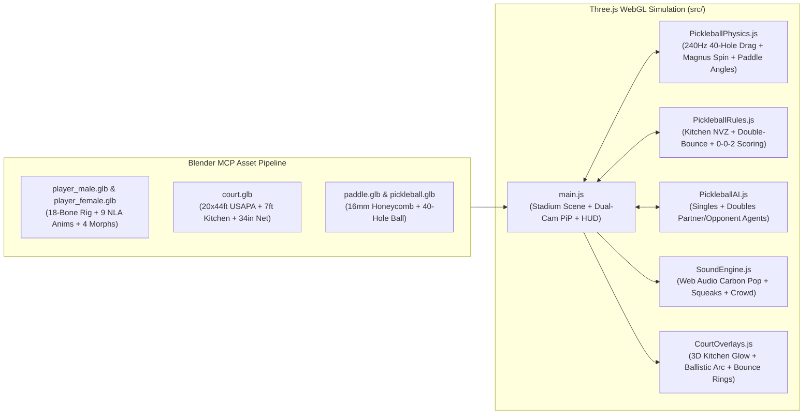

# 🏓 PPA Tour 3D Pickleball Simulator & Interactive USAPA Rule Trainer

A realistic **3D WebGL Pickleball Simulation Game** and **Interactive USAPA Rule Trainer** built with **Three.js**, **Web Audio API**, and **Blender MCP** procedurally generated 3D human athletes, equipment, and court assets.

---

## 📸 Actual Live Game Screenshots

### 1. Pro Broadcast Center Court View (Interactive USAPA Coach & Hawkeye AR)

*Championship Center Court broadcast view featuring 16x-anisotropic Laykold/SportMaster silica-grit acrylic court surfaces, subtle Hawkeye AR target overlays, covered East/West grandstand pavilions with articulated seated spectators, shaded umpire high-chair with 3D referee, LED sponsor perimeter boards, and non-overlapping ESPN/PPA Tour TV broadcast HUD.*

### 2. PPA Championship 2v2 Doubles Match (`0 - 0 - 2` Side-Out Scoring)

*Full 2v2 Championship Doubles match with distinct pro team kits (**Team Near**: Royal Cobalt & Navy vs **Team Far**: Pro Crimson & Slate), live serve ballistic trajectory arc, and coordinated AI partner/opponent positioning.*

### 3. Athlete & T700 Carbon Paddle Close-Up Cam (`Face Cam` + PiP Emotion Cam)

*Close-up portrait view of **Arjun** holding the 16mm **T700 Raw Carbon-Fiber Honeycomb Paddle**, showcasing continuous manifold human head/neck/torso sculpting, natural cranial & hair volume, almond eyes with upper eyelids and dark-brown irises, subtle 3D labial contours, and live facial morph targets.*

### 4. Kitchen Net Cam & 40-Hole Paddle Contact / Spin Lab

*Sideline Non-Volley Zone ("Kitchen") camera angle alongside **Ananya (AI)** at the 7-foot Kitchen line, with the interactive **Paddle Contact Angles & 40-Hole Lab** drawer open for real-time pitch, yaw, brush spin, and crosswind tuning.*

### 5. Overhead Tactical Hawkeye View

*Top-down tactical view highlighting USAPA 20×44 ft court geometry, 7-foot Non-Volley Zone ("The Kitchen") boundaries, doubles footwork coverage, and 240Hz Magnus spin trajectory arcs.*

---

## ✨ Key Highlights

### 1. Lifelike 3D Human Athletes & Real-Time Human Emotions (Via Blender MCP)
- **Anatomically Sculpted Male & Female Pro Athletes** (`public/assets/player_male.glb`, `public/assets/player_female.glb`):
  - **Arjun** & **Priya** (Team Near — Royal Cobalt / Teal kits) and **Vikram** & **Ananya** (Team Far — Pro Crimson & Slate kits) modeled as continuous manifold smooth-shaded meshes (`~7,350` vertices per athlete) with realistic cranial breadth, voluminous athletic hair crowns, sweatbands, almond-shaped eyes with upper eyelids, dark-brown irises, corneal catchlights, sculpted eyebrows, 3D noses, natural tapered lips, and athletic limb musculature.
- **4 Subtle Facial Emotion Shape Keys (Morph Targets)**:
  - `Celebration`: Natural smile with lifted mouth corners and eyebrows on winning points.
  - `Frustration`: Subtle downturned mouth and furrowed inner brows on unforced errors and faults.
  - `Effort`: Focused athletic grit expression during overhead smashes and topspin drives.
  - `Surprise`: Expressive reaction on net-cord rolls and reflex kitchen volleys.
- **9 Rigged Skeletal Animations (NLA Tracks)**:
  - **7 Court Strokes & Footwork**: `Idle_SplitStep`, `Run_Footwork`, `Serve_Underhand`, `Dink_Crosscourt`, `ThirdShot_Drop`, `Volley_Kitchen`, `Smash_Overhead`.
  - **2 Full-Body Human Emotion Reactions**: `Celebrate_FistPump` (victory jump & double fist-pump) and `Frustrated_Slump` (head-shake & hand-to-forehead slump).
- **Live 3D "Human Emotion Cam" (Picture-in-Picture)**:
  - A secondary Three.js portrait camera (`faceCamera`) renders a live 60 FPS front-facing close-up of the athlete's face and upper body directly inside the top-right broadcast HUD.

### 2. USAPA-Standard 3D Equipment & Pro Outdoor Championship Stadium
- **20×44 ft USAPA Tournament Court (`public/assets/court.glb` + Procedural 4K Silica-Grit Acrylic Shader)**:
  - Exact USAPA dimensions (`6.096 m × 13.4112 m`), US Open Blue service courts, Pro Light-Blue **7-foot Non-Volley Zone ("The Kitchen")**, Emerald Championship run-off apron, 16x-anisotropic Laykold/SportMaster micro-grit normal/bump mapping, and a physically modeled **36-inch sideline / 34-inch center parabolic sag net** with woven cord alpha mesh and center strap.
- **Polypropylene Honeycomb & Raw Carbon Paddle (`public/assets/paddle.glb`)**:
  - `16.5" × 7.5"` 16mm paddle with baked polypropylene honeycomb core + T700 raw carbon-fiber face texture, TPU edge guard, and spiral octagonal grip attached to each athlete's `Hand.R` bone.
- **40-Hole Outdoor Pickleball (`public/assets/pickleball.glb`)**:
  - `73.66 mm` diameter hollow optic-yellow ball with 40 precision circular aerodynamic holes.
- **Pro Tour Championship Stadium**:
  - Procedural HDR environment lighting (`PMREMGenerator`), 4096×4096 soft shadow maps, atmospheric sky dome with volumetric-style FBM cumulus clouds, covered East & West grandstand pavilions with cantilevered roofs, glass safety balustrades, molded stadium bucket seats, **36 articulated seated 3D spectators**, aluminum umpire high-chair with sun canopy and seated 3D referee, courtside player benches & coolers, LED sponsor perimeter boards (`PPA INDIA OPEN`, `T700 CARBON PRO`, `DUPR PRO ANALYTICS`), 4 multi-cell LED floodlight masts, and multi-cluster stadium trees.

### 3. Broadcast TV HUD & On-Screen Interactive Key Guide
- **ESPN / PPA Tour TV Scorebug**: Live serving indicators, team rows, game score, official `0 - 0 - 2` USAPA 3-number call box, and a real-time **Double-Bounce Rule Status Strip**.
- **Subtle Hawkeye AR Court Overlays (`src/ui/CourtOverlays.js`)**: Translucent broadcast-grade target rings, glow borders, and 3D ballistic trajectory arcs that preserve the realistic acrylic court texture beneath.
- **Live Contextual Key Prompt Banner**: Dynamically tells you **what keys to hit right now** at every phase of a rally (e.g., *Your Serve*, *Wait for Double-Bounce*, *Kitchen Dink*, *High Ball Smash*).
- **Interactive On-Screen Keycaps**: Visual keycaps for `[W][A][S][D]`, `[1]–[6]` Shot Types (with automatic **`RECOMMENDED`** badges), `[SPACE] / [🖱️ CLICK]` (with live power-charge meter), and `[Q]/[E]`, `[R]/[F]` paddle shaping that light up as you press them.

---

## 🏗️ System Architecture



---

## 🎮 Controls & On-Screen Key Guide

| Input / Key | Action | Details |
| :--- | :--- | :--- |
| **Mouse Move** | **Aim Target Reticle** | Moves the 3D target reticle and live ballistic trajectory arc on the opposing court |
| **Hold & Release `SPACE`** *(or **Left-Click**)* | **Serve / Strike Ball** | Charges shot power (`35%–100%`) and swings the paddle on release |
| **`1`** | **Topspin Drive / Serve** | Deep baseline topspin drive (`+1850 RPM`) or legal underhand serve |
| **`2`** | **Crosscourt Kitchen Dink** | Soft lifted arc that drops inside the opponent's 7ft Non-Volley Zone |
| **`3`** | **Aggressive 3rd-Shot Drop** | High-margin transition drop from baseline into the Kitchen after Bounce #2 |
| **`4`** | **Kitchen-Line Punch Volley** | Compact reflex punch volley out of the air (outside the 7ft Kitchen) |
| **`5`** | **Overhead Smash** | High-velocity leaping put-away winner against high balls/lobs |
| **`6`** | **Backspin Slice** | Open-face backspin cut (`-1650 RPM`) that floats via Magnus lift and skids low |
| **`W` `A` `S` `D`** *(or **Arrow Keys**)* | **Court Footwork** | Manual player movement (works seamlessly alongside **Auto-Footwork Assist**) |
| **`Q` / `E`** | **Paddle Face Pitch** | Close paddle face (`-15°` low drive) ↔ Open paddle face (`+20°` lofted dink/drop) |
| **`Z` / `C`** | **Paddle Face Yaw** | Angle paddle face Inside-Out Left (`-25°`) ↔ Crosscourt Right (`+25°`) |
| **`R` / `F`** | **Swing Brush Spin** | Increase Topspin brush (`+25°`) ↔ Increase Backspin slice (`-25°`) |
| **Right-Click + Drag** | **Orbit 3D Camera** | Freely orbit, pan, and zoom the 3D stadium camera |

---

## 🎯 Game Modes

1. **🎓 Training Coach Mode (Interactive USAPA Rule Tutorial)**:
   - **Lesson 1 — The Non-Volley Zone ("The Kitchen")**: Learn the 7-foot no-volley rule and land 3 soft crosscourt dinks inside the Kitchen.
   - **Lesson 2 — Legal Underhand Serve**: Strike legal underhand pendulum serves below the waist into the highlighted diagonal service court.
   - **Lesson 3 — The Double-Bounce (Two-Bounce) Rule**: Let the opponent's return bounce once (Bounce #2), then execute a **3rd-Shot Drop (`[3]`)** into the Kitchen to advance to the net.
   - **Lesson 4 — Side-Out Scoring (`0-0-2`)**: Play live points where only the serving team scores.
   - **Lesson 5 — 40-Hole Aerodynamics & Spin Lab**: Experiment with paddle pitch, yaw, topspin Magnus dip, backspin float, and crosswind.
2. **⚡ Singles Mode (1v1 Match)**:
   - Full USAPA Singles rules with even (`Right`) and odd (`Left`) server court positioning against **Vikram (Tour AI)**.
3. **🏆 Doubles Mode (2v2 Co-op & AI Match)**:
   - Full USAPA `0-0-2` three-number scoring with **Priya (AI Partner)** coordinating kitchen-line transitions, serving rotations (`Server #1` / `Server #2`), and Left/Right side switches against **Vikram & Ananya (AI)**.

---

## 🔬 High-Precision Physics & Spatial Audio

- **40-Hole Aerodynamic Drag & Magnus Effect (`src/physics/PickleballPhysics.js`)**:
  - Sub-stepped at `240 Hz` using 4th-order Runge-Kutta / semi-implicit Euler integration:
    $$\mathbf{a} = \mathbf{g} - \frac{1}{2 m}\rho A C_d \|\mathbf{v}_{\text{rel}}\|\mathbf{v}_{\text{rel}} + \frac{1}{2 m}\rho A C_L \frac{\boldsymbol{\omega} \times \mathbf{v}_{\text{rel}}}{\|\boldsymbol{\omega}\|} \|\mathbf{v}_{\text{rel}}\|^2$$
  - Models a `26 g`, `73.66 mm` USAPA 40-hole outdoor ball ($C_d = 0.44$, $C_L = 0.21$), parabolic net cord collisions (`34"` center / `36"` posts), and spin-coupled acrylic court restitution.
- **Web Audio API Spatial Synthesis (`src/audio/SoundEngine.js`)**:
  - Procedural **T700 Raw Carbon-Fiber** (`1.15 kHz`) and **Pro Graphite** (`1.48 kHz`) honeycomb paddle "pop" transients, FM rubber court-shoe squeaks, hollow polymer court bounces, dynamic crowd cheers/gasps, and spoken referee score announcements.

---

## 🚀 Quick Start & Verification

### Prerequisites
- **Node.js** `>= 18.x` and **npm**

### Install & Run Locally
```bash
# 1. Clone the repository
git clone https://github.com/cmanikandan/pickleball.git
cd pickleball

# 2. Install dependencies
npm install

# 3. Start the Vite development server (http://localhost:5173/)
npm run dev
```

### Run Automated Verification Suite & Production Build
```bash
# Verifies all 5 Blender GLB assets, 9 animations, 4 emotion shape keys,
# 40-hole Magnus physics, USAPA Kitchen/Double-Bounce/0-0-2 rules, and AI agents:
npm test

# Build production bundle to dist/
npm run build
```

---

## 📁 Project Structure

```text
pickleball/
├── AGENTS.md                       # AI Coding Agent, Blender MCP & Multi-Agent Architecture Guide
├── README.md                       # Project documentation, controls, architecture & setup
├── index.html                      # TV Broadcast Scorebug, Live 3D Emotion PiP & Keycap HUD
├── package.json                    # Scripts and dependencies (three, vite)
├── public/assets/                  # Blender MCP generated 3D GLB assets
│   ├── court.glb                   # 20x44ft USAPA court, 7ft Kitchen & 34"/36" parabolic net
│   ├── paddle.glb                  # 16mm honeycomb core + T700 carbon-fiber paddle
│   ├── pickleball.glb              # 73.66mm USAPA outdoor ball with 40 circular holes
│   ├── player_male.glb             # Rigged male athlete (Arjun) + 9 animations + 4 emotion morphs
│   └── player_female.glb           # Rigged female athlete (Priya) + 9 animations + 4 emotion morphs
├── public/screenshots/             # Actual live in-game WebGL screenshots
│   ├── broadcast_view.png          # Pro broadcast center court view & USAPA coach
│   ├── doubles_match.png           # 2v2 championship doubles match in action
│   ├── athlete_closeup.png         # Close-up hero portrait of athlete & T700 carbon paddle
│   ├── kitchen_angle_lab.png       # Kitchen net cam & 40-hole paddle contact / spin lab
│   └── overhead_tactical.png       # Overhead tactical Hawkeye view
├── src/
│   ├── main.js                     # Three.js WebGL scene, outdoor stadium, PiP camera & loop
│   ├── style.css                   # Broadcast UI styling & interactive keycap animations
│   ├── ai/PickleballAI.js          # Multi-agent tactical AI (Singles, Doubles partner/opponents)
│   ├── audio/SoundEngine.js        # Web Audio API spatial synthesis engine
│   ├── physics/PickleballPhysics.js# 240Hz 40-hole drag, Magnus spin & paddle contact solver
│   ├── rules/PickleballRules.js    # USAPA rule validator & 5 interactive training modules
│   └── ui/CourtOverlays.js         # 3D holographic court overlays & trajectory preview
└── tests/
    └── verify_simulation.mjs       # Automated verification test suite
```
