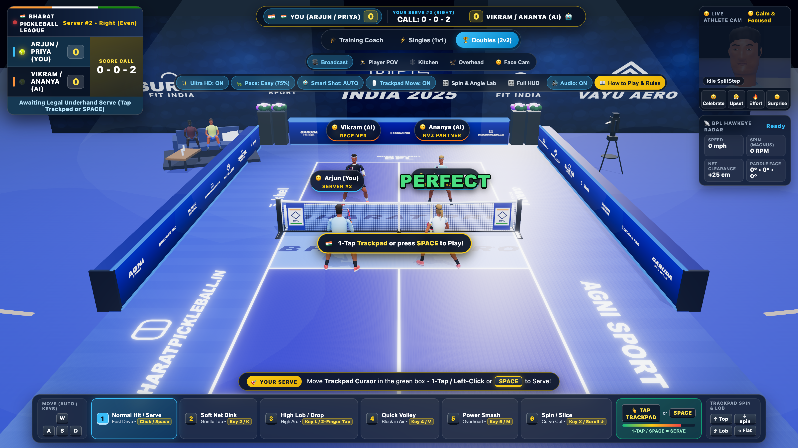
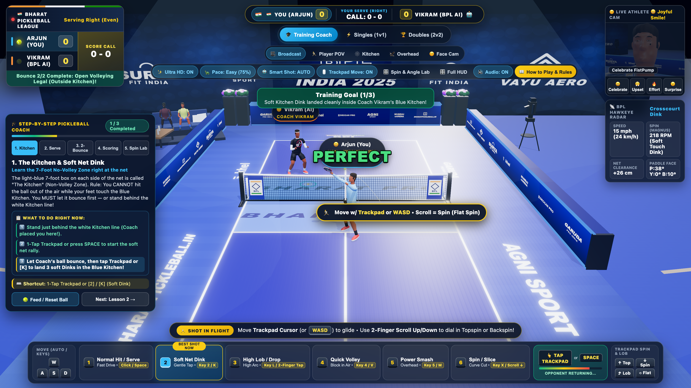
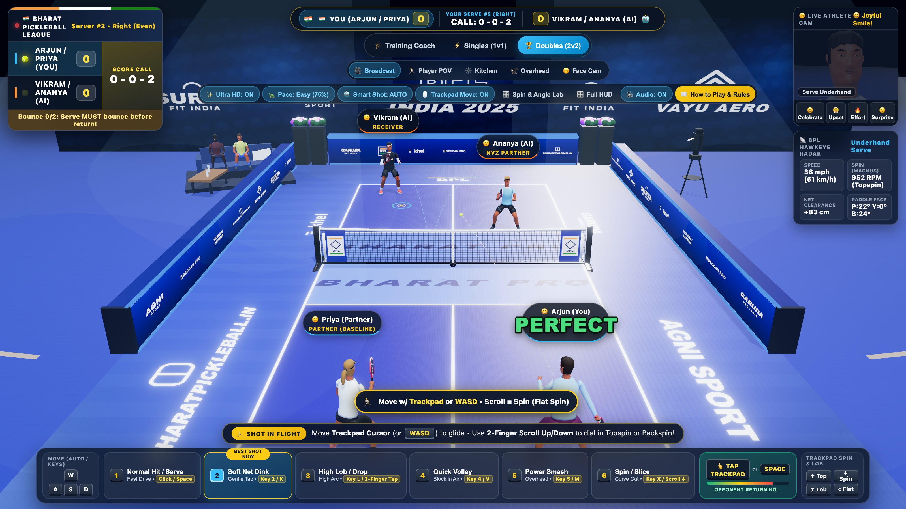
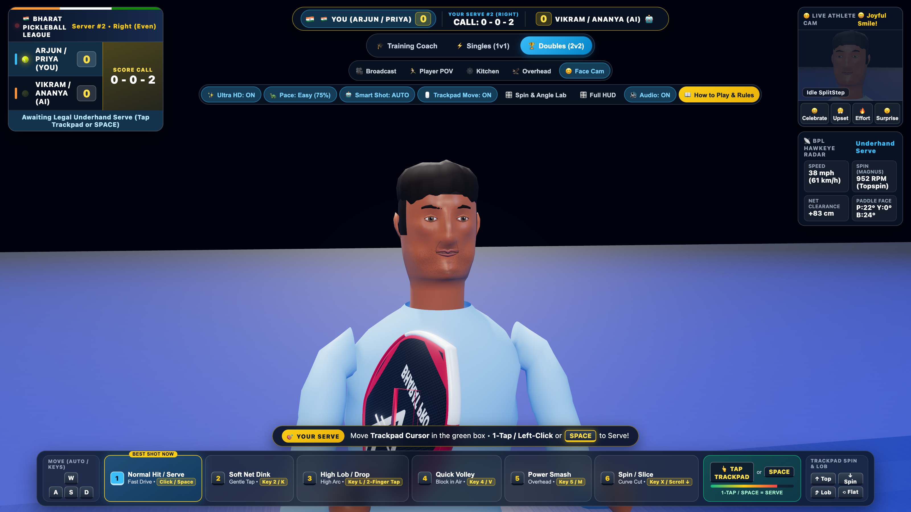
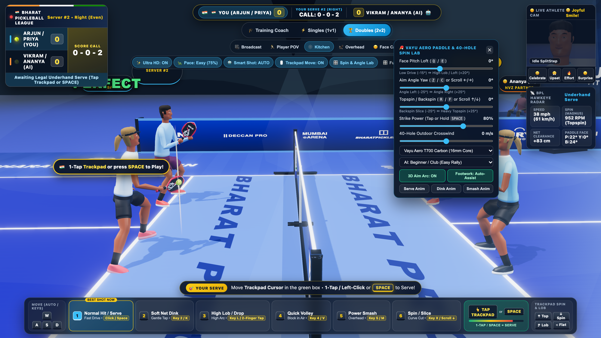
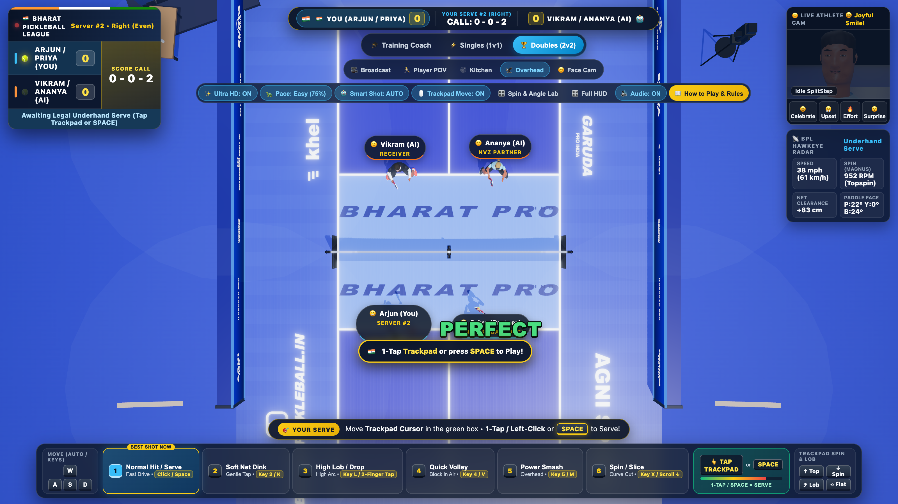
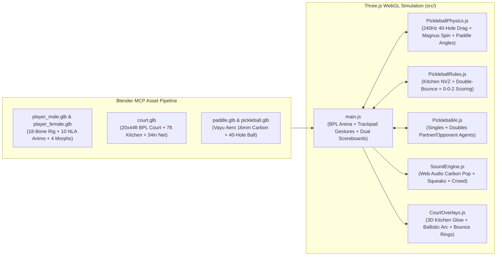

# 🇮🇳 Bharat Pickleball League (BPL 2025) — Ultra-HD 3D Pickleball Simulator & Interactive Coach

A realistic **Ultra-HD 3D WebGL Pickleball Simulation Game** and **Interactive Step-by-Step USAPA / AIPA Rule Coach** built with **Three.js** (`4x MSAA` + `UnrealBloom` + `4K PBR Materials`), **Web Audio API**, and **Blender MCP** procedurally generated 3D Indian pro athletes, equipment, and stadium court assets — featuring **100% original, copyright-free Indian Tour branding** and **extensive Laptop Trackpad + Beginner Controls**.

---

## 📸 Actual Live Ultra-HD Game Screenshots

### 1. Bharat Pickleball League (BPL 2025) Ultra-HD Broadcast View & Live Scoreboards

*Ultra-HD (`4096×6144` acrylic clearcoat court + `4x MSAA` + `4096×4096` shadows) Bharat Pickleball League (BPL 2025) indoor/night Mumbai Championship Arena featuring 100% original Indian tour branding (`BHARAT PRO` Kitchen stencils, `BHARAT PICKLEBALL LEAGUE (BPL)` baseline logo, `khel`, `BHARATPICKLEBALL.IN`, `AGNI SPORT`, and `GARUDA PRO INDIA` apron decals), portable tournament net with braided cord mesh & `BPL` Diamond-Lotus banners, overhead LED floodlight trusses, Top-Left BPL TV Scorebug + Center-Top Live Scoreboard Pill, Floating 3D On-Court Action Coach Pill, and Everyday Shot + Trackpad Deck.*

### 2. Interactive Step-by-Step Coaching Mode (`🎓 Training Coach` Live Drill)

*Interactive **5-Lesson Step-by-Step Coaching Mode** showing the plain-English **Coach's Live Checklist** (`1️⃣`, `2️⃣`, `3️⃣` steps lighting up green in real time), live completion progress bar (`1 / 3 Completed`), `🎾 Feed / Reset Ball` & `Next Lesson →` controls, and automatic Kitchen-line / Baseline drill positioning.*

### 3. BPL Championship 2v2 Doubles Match (`0 - 0 - 2` Side-Out Scoring & Full Broadcast HUD)

*Full 2v2 Championship Doubles match with always-visible Top-Left & Top-Center Live Scoreboards (`0 - 0 - 2`), Floating On-Court Action Helper, Live 3D Emotion PiP cam, and distinct Indian pro athlete kits (**Arjun**: sky-blue long-sleeve performance kit; **Priya**: navy jersey & pleated court skirt; **Vikram**: black short-sleeve jersey over white long compression sleeves + headband; **Ananya**: lavender performance tee & pleated white skirt).*

### 4. Athlete & Vayu Aero Carbon Paddle Ultra-HD Close-Up Cam (`Face Cam` + 3K Carbon Weave)

*Ultra-HD close-up portrait of **Arjun** holding the **Vayu Aero / Bharat Pro T700 Raw Carbon-Fiber Paddle** (`1024×1024` stencil + `3K` carbon-twill normal map + clearcoat sheen) in a natural forward continental grip (`Hand.R`), showcasing `2048×2048` lifelike skin subsurface sheen, woven athletic pique jersey micro-texture, and live facial morph targets.*

### 5. Kitchen Net Cam & 40-Hole Paddle Contact / Spin Lab

*Sideline Non-Volley Zone ("Kitchen") camera angle alongside **Ananya (AI)** at the 7-foot Kitchen line, with the interactive **Vayu Aero Paddle & 40-Hole Spin Lab** drawer open for real-time pitch, yaw, brush spin, and crosswind tuning.*

### 6. Overhead Tactical Hawkeye View

*Top-down tactical view highlighting 20×44 ft 3-tone blue court geometry, `BHARAT PRO` 7-foot Non-Volley Zone ("The Kitchen") stencils, doubles footwork coverage, and 240Hz Magnus spin trajectory arcs.*

---

## ✨ Key Highlights

### 1. Ultra-HD (4K PBR & 4x MSAA Broadcast Post-Processing) Pipeline
- **Super-Sampled Retina / 4K Rendering (`✨ Ultra HD: ON` Toggle)**:
  - Renders up to `2.5x` super-sampled device pixel ratio with a `HalfFloatType` **4x Hardware MSAA** `EffectComposer`, HDR `UnrealBloomPass` for overhead stadium LED floodlights, `OutputPass` ACES Filmic tone mapping, and `4096×4096` `PCFSoftShadowMap` shadows.
- **High-Definition Physically Based Materials (`MeshPhysicalMaterial`)**:
  - **Court & Net**: `4096 × 6144` master court canvas (`~350 DPI` crisp line stencils), `512 × 512` tangent-space silica-sand acrylic grit normal map + clearcoat sheen, and `512 × 512` braided cord net mesh.
  - **Athletes & Equipment**: `2048 × 2048` skin texture with physical subsurface sheen, `256 × 256` repeating athletic pique jersey weave normal map, and `1024 × 1024` Vayu Aero paddle face with a `3K` carbon-twill spin-grit normal map.

### 2. 100% Copyright-Free Indian Pickleball League (BPL 2025) Arena & Equipment
- **Original Indian Sports & Tour Branding (Zero Third-Party Trademarks)**:
  - **Tournament League**: `BHARAT PICKLEBALL LEAGUE (BPL) • INDIA 2025` with a stylized Ashoka-Navy & Gold Diamond-Lotus emblem.
  - **Original Fictional Indian Sponsors**: `BHARAT PRO` (Kitchen & Paddle Face), `VAYU AERO` (3D Carbon Paddle Crest & Back Wall), `SURYA FIT INDIA`, `AGNI SPORT`, `GARUDA PRO INDIA`, `khel`, `DECCAN PRO`, `MUMBAI ARENA`, and `BHARATPICKLEBALL.IN`.
- **Anatomically Proportioned Male & Female Indian Pro Athletes** (`public/assets/player_male.glb`, `public/assets/player_female.glb`):
  - **Arjun** & **Priya** (Team Near) and **Vikram** & **Ananya** (Team Far) sculpted and rigged in Blender with athletic V-taper torsos, smooth deltoid shoulder skinning, natural wide split-step stances (`±0.21m` foot spacing), dedicated material slots (`Headband_Mat`, `Forearm_Sleeve_Mat`, `Shirt_Mat`, `Shorts_Mat`), and distinct pro tournament kits.
- **Forward Continental Paddle Grip (`public/assets/paddle.glb`)**:
  - Elongated **Vayu Aero / Bharat Pro T700 Raw Carbon-Fiber Paddle** (`16.5" × 7.5"`, 16mm honeycomb core, 3D Vayu Aero diamond-chevron crest, crimson edge guard, perforated leather grip) exported with origin `(0, 0, 0)` at the palm grip center so `Hand.R` holds the handle naturally in front of the chest (`~38°` forward pitch).
- **4 Subtle Facial Emotion Shape Keys & 10 Rigged Skeletal Animations**:
  - `Celebration`, `Frustration`, `Effort`, and `Surprise` morph targets + 10 NLA animations (`Idle_SplitStep`, `Run_Footwork`, `Serve_Underhand`, `Dink_Crosscourt`, `ThirdShot_Drop`, `Volley_Kitchen`, `Smash_Overhead`, `Celebrate_FistPump`, `Frustrated_Slump`, `Seated_Spectator`).

### 3. Unmistakable Dual Live Scoreboards, Interactive Step-by-Step Coach & Laptop Controls
- **Always-Visible Dual Scoreboards**:
  - **Top-Left BPL TV Scorebug (`#tv-scorebug`)**: Features an Indian Tricolor header bar, live serving ball indicator (`🎾`), large team score badges, `SCORE CALL 0 - 0 - 2` call box, and a real-time **Double-Bounce Rule Status Strip**.
  - **Center-Top Live Scoreboard Pill (`#center-scoreboard-pill`)**: Keeps `🇮🇳 YOU (0) — CALL: 0 - 0 - 2 — (0) VIKRAM / ANANYA (AI) 🤖` right in your line of sight at the top center of the screen.
- **Floating 3D On-Court Action Helper Pill (`#on-court-helper-pill`)**:
  - Follows your player right on the 3D court (`🎯 YOUR SERVE: 1-Tap Trackpad or SPACE`, `⏳ LET IT BOUNCE FIRST!`, `⚡ HIT NOW! 1-Tap Normal • 2-Finger/L Lob`) so you never have to look away from the ball.
- **Beginner-Friendly Pace & Smart Auto-Shot**:
  - Defaults to **`🐢 Pace: Easy (75%)`** (toggleable to `Normal 90%` and `Pro 100%`), **`🤖 Smart Shot: AUTO`** (automatically picks Dink at the Kitchen, 3rd-Shot Drop from baseline, Smash on high balls, or Drive), and a **480ms forgiving swing input buffer** (tap slightly early and your player automatically swings when the ball arrives!).

---

## 🏗️ System Architecture



---

## 💻 Laptop Trackpad / Mousepad & Everyday Keyboard Controls

| Laptop Trackpad / Key | Everyday Shot / Action | Plain-English Details |
| :--- | :--- | :--- |
| **1-Finger Tap / Left-Click** *(or `SPACE`)* | **Normal Hit / Serve** | Serves into the green box or hits the ball (includes a forgiving **480ms early-tap buffer**!) |
| **2-Finger Tap / Right-Click** *(or `L` / `3`)* | **High Lob / Drop Shot** | Instantly selects & swings a high defensive **Lob / Drop Shot** over the net |
| **2-Finger Scroll Up / Down** *(or `R` / `F`)* | **Topspin / Backspin Slice** | Scroll Up for **Topspin dip (`+RPM`)**; Scroll Down for **Backspin slice (`-RPM`)** |
| **2-Finger Scroll Left / Right** *(or `Z` / `C`)* | **Angle Left / Right** | Angles the paddle face cross-court Left or Right (`-25°` to `+25°`) |
| **Move Cursor on Trackpad** | **Aim & Glide Player (`Trackpad Move: ON`)** | Moves the 3D aim target AND gently glides your player toward the ball on your half of the court |
| **`1`** | **Normal Hit / Serve (`Drive`)** | Fast, deep baseline drive or legal underhand serve |
| **`2` or `K`** | **Soft Net Dink (`Dink`)** | Gentle tap that drops softly into the opponent's 7ft Kitchen |
| **`3` or `L`** | **High Lob / Drop (`Drop`)** | High arc lob / 3rd-shot drop into the Kitchen |
| **`4` or `V`** | **Quick Volley (`Volley`)** | Punch block in the air at the net (outside the 7ft Kitchen) |
| **`5` or `M`** | **Power Smash (`Smash`)** | Overhead put-away winner on high balls |
| **`6` or `X`** | **Spin / Slice (`Slice`)** | Curved backspin slice that floats and skids low |
| **`W` `A` `S` `D`** *(or **Arrow Keys**)* | **Court Footwork** | Manual movement (works seamlessly alongside **Trackpad Move** & **Auto-Footwork**) |
| **`Shift + Drag`** *(or **Middle-Click Drag**)* | **Orbit 3D Camera** | Orbit and inspect the 3D stadium from any angle |

---

## 🎯 Game Modes

1. **🎓 Training Coach Mode (Interactive USAPA Rule Tutorial)**:
   - **Lesson 1 — The Non-Volley Zone ("The Kitchen")**: Learn the 7-foot no-volley rule and land 3 soft crosscourt dinks inside the Kitchen.
   - **Lesson 2 — Legal Underhand Serve**: Strike legal underhand pendulum serves below the waist into the highlighted diagonal service court.
   - **Lesson 3 — The Double-Bounce (Two-Bounce) Rule**: Let the opponent's return bounce once (Bounce #2), then execute a **3rd-Shot Drop (`[3]`)** into the Kitchen to advance to the net.
   - **Lesson 4 — Side-Out Scoring (`0-0-2`)**: Play live points where only the serving team scores.
   - **Lesson 5 — 40-Hole Aerodynamics & Spin Lab**: Experiment with paddle pitch, yaw, topspin Magnus dip, backspin float, and crosswind.
2. **⚡ Singles Mode (1v1 Match)**:
   - Full USAPA Singles rules with even (`Right`) and odd (`Left`) server court positioning against **Vikram (Tour AI)**.
3. **🏆 Doubles Mode (2v2 Co-op & AI Match)**:
   - Full USAPA `0-0-2` three-number scoring with **Priya (AI Partner)** coordinating kitchen-line transitions, serving rotations (`Server #1` / `Server #2`), and Left/Right side switches against **Vikram & Ananya (AI)**.

---

## 🔬 High-Precision Physics & Spatial Audio

- **40-Hole Aerodynamic Drag & Magnus Effect (`src/physics/PickleballPhysics.js`)**:
  - Sub-stepped at `240 Hz` using 4th-order Runge-Kutta / semi-implicit Euler integration:
    $$\mathbf{a} = \mathbf{g} - \frac{1}{2 m}\rho A C_d \|\mathbf{v}_{\text{rel}}\|\mathbf{v}_{\text{rel}} + \frac{1}{2 m}\rho A C_L \frac{\boldsymbol{\omega} \times \mathbf{v}_{\text{rel}}}{\|\boldsymbol{\omega}\|} \|\mathbf{v}_{\text{rel}}\|^2$$
  - Models a `26 g`, `73.66 mm` USAPA 40-hole outdoor ball ($C_d = 0.44$, $C_L = 0.21$), parabolic net cord collisions (`34"` center / `36"` posts), and spin-coupled acrylic court restitution.
- **Web Audio API Spatial Synthesis (`src/audio/SoundEngine.js`)**:
  - Procedural **T700 Raw Carbon-Fiber** (`1.15 kHz`) and **Pro Graphite** (`1.48 kHz`) honeycomb paddle "pop" transients, FM rubber court-shoe squeaks, hollow polymer court bounces, dynamic crowd cheers/gasps, and spoken referee score announcements.

---

## 🚀 Quick Start & Verification

### Prerequisites
- **Node.js** `>= 18.x` and **npm**

### Install & Run Locally
```bash
# 1. Clone the repository
git clone https://github.com/cmanikandan/pickleball.git
cd pickleball

# 2. Install dependencies
npm install

# 3. Start the Vite development server (http://localhost:5173/)
npm run dev
```

### Run Automated Verification Suite & Production Build
```bash
# Verifies all 5 Blender GLB assets, 9 animations, 4 emotion shape keys,
# 40-hole Magnus physics, USAPA Kitchen/Double-Bounce/0-0-2 rules, and AI agents:
npm test

# Build production bundle to dist/
npm run build
```

---

## 📁 Project Structure

```text
pickleball/
├── AGENTS.md                       # AI Coding Agent, Blender MCP & Multi-Agent Architecture Guide
├── README.md                       # Project documentation, controls, architecture & setup
├── index.html                      # TV Broadcast Scorebug, Live 3D Emotion PiP & Keycap HUD
├── package.json                    # Scripts and dependencies (three, vite)
├── public/assets/                  # Blender MCP generated 3D GLB assets
│   ├── court.glb                   # 20x44ft USAPA court, 7ft Kitchen & 34"/36" parabolic net
│   ├── paddle.glb                  # 16mm honeycomb core + T700 carbon-fiber paddle
│   ├── pickleball.glb              # 73.66mm USAPA outdoor ball with 40 circular holes
│   ├── player_male.glb             # Rigged male athlete (Arjun) + 9 animations + 4 emotion morphs
│   └── player_female.glb           # Rigged female athlete (Priya) + 9 animations + 4 emotion morphs
├── public/screenshots/             # Actual live in-game WebGL screenshots
│   ├── broadcast_view.png          # Pro broadcast center court view & USAPA coach
│   ├── doubles_match.png           # 2v2 championship doubles match in action
│   ├── athlete_closeup.png         # Close-up hero portrait of athlete & T700 carbon paddle
│   ├── kitchen_angle_lab.png       # Kitchen net cam & 40-hole paddle contact / spin lab
│   └── overhead_tactical.png       # Overhead tactical Hawkeye view
├── src/
│   ├── main.js                     # Three.js WebGL scene, outdoor stadium, PiP camera & loop
│   ├── style.css                   # Broadcast UI styling & interactive keycap animations
│   ├── ai/PickleballAI.js          # Multi-agent tactical AI (Singles, Doubles partner/opponents)
│   ├── audio/SoundEngine.js        # Web Audio API spatial synthesis engine
│   ├── physics/PickleballPhysics.js# 240Hz 40-hole drag, Magnus spin & paddle contact solver
│   ├── rules/PickleballRules.js    # USAPA rule validator & 5 interactive training modules
│   └── ui/CourtOverlays.js         # 3D holographic court overlays & trajectory preview
└── tests/
    └── verify_simulation.mjs       # Automated verification test suite
```
